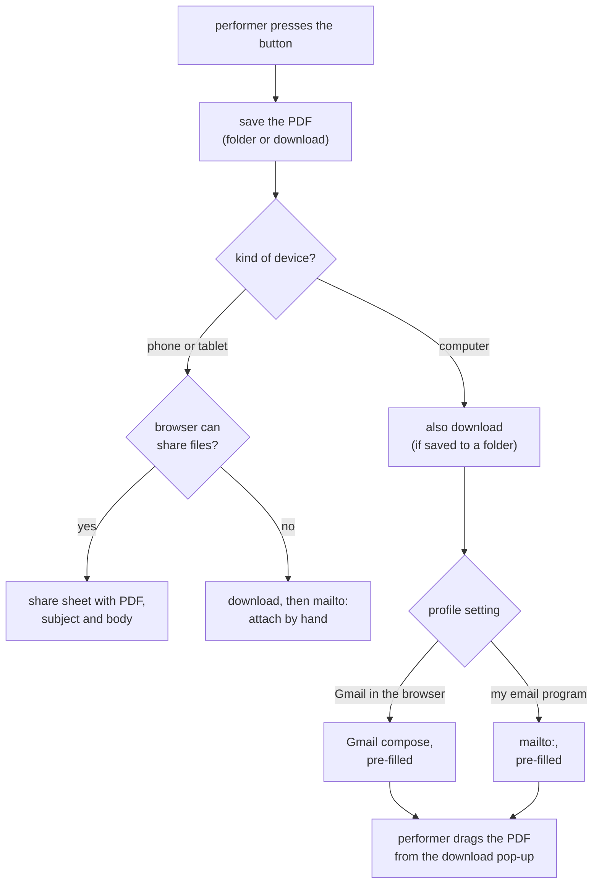

# ADR-0001: Phones share the PDF; computers save it, download it and open a pre-filled email (resolves OPEN-B)

- **Status:** Proposed
- **Date:** 2026-11-13

## Context

[OPEN-B](../requirements.md#open-b) asks how the invoice PDF gets into the [performer](../glossary.md#performer)'s email as an attachment.
[REQ-022](../requirements.md#req-022) requires the sending step to open with the PDF attached and the subject and body pre-filled.
[REQ-014](../requirements.md#req-014) asks for one button, after which "the share or email screen opens with the PDF attached".
[REQ-019](../requirements.md#req-019) requires the PDF to be saved first.
[REQ-029](../requirements.md#req-029) puts the platform differences behind one interface.

The [share and PDF spike](../spikes/2026-11-12-share-and-pdf.md) measured each candidate on Thomas's devices on 12 and 13 November 2026:

- **Android, Chrome:** the [Web Share API](../glossary.md#web-share-api) opens the Gmail app with the PDF attached, the subject and the body.
  The recipient stays empty.
- **Android, Firefox:** it shares no files.
- **Windows, Chrome:** the browser offers file sharing, but the Windows [share sheet](../glossary.md#share-sheet) has no Gmail, because a website cannot receive a Windows share.
  Firefox on Windows has no sharing at all.
- **Windows, all browsers:** saving the PDF and opening Gmail's compose page pre-filled works.
  Recipient, subject and body arrive, umlauts included.
  One action remains: dragging the PDF from the browser's download pop-up into the compose window.
  No drag source on the page itself worked.
- **Windows, `.eml` draft:** it opens in new Outlook, which Thomas does not use.

Thomas discussed the options on 13 November 2026.
He chose the save-and-download variant for computers with a chosen folder (option 3 below).

## Decision

**On a phone or tablet whose browser can share files, abendkasse saves the PDF and opens the share sheet with the PDF, the subject and the body.**
The performer picks the email app and the recipient there.

**On a computer, abendkasse saves the PDF, downloads it as well, and opens a pre-filled email with recipient, subject and body.**
The performer drags the PDF from the browser's download pop-up into the email.
Where the performer has chosen an invoice folder ([REQ-019](../requirements.md#req-019)), abendkasse writes the PDF there and downloads a second copy.
The download is what puts the PDF into the pop-up, one drag away from the email.

**On a computer, the performer chooses in the [profile](../glossary.md#profile) where the email opens:**

| Choice | What opens | Default |
|---|---|---|
| Gmail in the browser | `https://mail.google.com/mail/?view=cm&fs=1&to=…&su=…&body=…` in a new window | yes |
| My email program | a `mailto:` link, which opens the computer's default email program | |

**On a phone or tablet whose browser cannot share files (Firefox on Android), abendkasse downloads the PDF and opens a `mailto:` link.**
The performer attaches the PDF from the downloads by hand.

**abendkasse decides by the kind of device, not by whether the browser says it can share files.**
Windows Chrome says it can, but its share sheet cannot reach Gmail in the browser.

Each way of sending is one implementation of the sending interface of [REQ-029](../requirements.md#req-029).

## Alternatives considered

- **1. Web Share on every platform:** on Windows the share sheet lists no Gmail, and Firefox on Windows has no sharing.
  The performer would end up in a dialog with nothing useful in it.
- **2. An `.eml` draft on computers:** it attaches the PDF without a drag, which made it the strongest alternative.
  It was set aside because it opens in the computer's default email program, not in Gmail in the browser.
  On Thomas's laptop that is new Outlook with no account.
- **3. With a chosen folder, write the PDF there only, and attach it in Gmail through the paperclip:** no second copy in the downloads.
  It takes about three actions instead of one drag, and it was not tested.
- **4. Drag the PDF straight from abendkasse's page into the email:** none of the four drag sources tested made an attachment in Gmail.
- **5. Gmail compose only, no `mailto:` choice:** simpler, but the Gmail compose address is not a documented Google interface.
  `mailto:` keeps a way open if Google changes it, and serves performers who do not use Gmail.

## Consequences

- On computers, one drag remains after the button.
  [REQ-014](../requirements.md#req-014)'s acceptance is rewritten per kind of device in the same change.
- With a chosen folder, every invoice leaves a second copy in the downloads folder.
  The performer can delete those copies; the archive is the folder.
- The Gmail compose address and the `mailto:` link carry the recipient, the subject and the body in the address.
  With Gmail, they reach Google when the window opens, before the performer presses send.
  This is the performer's own sending step, started by their button, so it does not count as abendkasse sending data ([REQ-024](../requirements.md#req-024) gets a note saying so).
- The Gmail compose address may change without notice.
  The `mailto:` choice is the fallback.
- Sending needs a network connection, unlike creating and saving ([REQ-027](../requirements.md#req-027)).
- The spike built the PDF before the button was pressed.
  Building it, saving it and then opening the share sheet or a new window from one press is not tested.
  Browsers allow sharing and new windows only shortly after a press.
  The first implementation tests this; if a step is blocked, a second button "Senden" opens the email.
- Not tested, carried over from the spike: iOS and macOS, Edge, the `mailto:` choice on Windows, Firefox on Android with `mailto:`.
